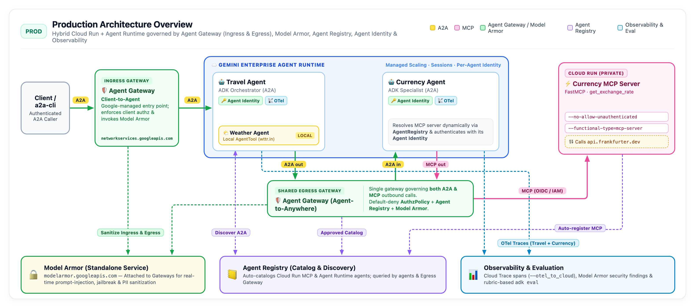

# Getting Started with MCP & A2A with ADK

[](https://www.python.org/)
[](https://openjdk.org/)
[](https://adk.dev/)
[](https://a2a-protocol.org/)
[](https://modelcontextprotocol.io/)
[](https://codelabs.developers.google.com/getting-started-mcp-a2a-adk)
[](LICENSE)

A sample multi-agent system demonstrating **Model Context Protocol (MCP)** and 
**Agent2Agent (A2A)** working together with **Agent Development Kit (ADK)**. 
All services can be run completely locally or fully deployed to Google Cloud Run.

> 🎓 **Hands-on Codelab:** Follow the step-by-step tutorial at **[Getting Started with MCP, A2A, and ADK Codelab](https://codelabs.developers.google.com/getting-started-mcp-a2a-adk)**.



---

## 🌐 Language Implementations

This sample is available in both **Python** and **Java**. Each folder contains its own setup, local execution, testing, and Cloud Run deployment instructions:

| Language | Directory | Stack |
| :--- | :--- | :--- |
| **🐍 Python** | [**`python/`**](python/README.md) | [ADK Python](https://github.com/google/adk-python), [A2A Python SDK](https://github.com/a2aproject/a2a-python), [FastMCP](https://github.com/jlowin/fastmcp), `uv` workspace |
| **☕ Java** | [**`java/`**](java/README.md) | [ADK Java](https://github.com/google/adk-java), [A2A Java SDK](https://github.com/a2aproject/a2a-java) (Quarkus), [MCP Java SDK](https://github.com/modelcontextprotocol/java-sdk), Maven |

---

## Overview

The sample aims at laying out a foundation and showcasing the capabilities
of MCP + A2A + ADK.

###  Model Context Protocol (MCP)

> MCP is an open protocol that standardizes how applications provide context to LLMs. Think of MCP like a USB-C port for AI applications. Just as USB-C provides a standardized way to connect your devices to various peripherals and accessories, MCP provides a standardized way to connect AI models to different data sources and tools. - [Anthropic](https://modelcontextprotocol.io/introduction)

The MCP server in this example exposes a tool `get_exchange_rate` that can be used to get the exchange rate between two currencies such as USD and EUR. It leverages the [Frankfurter](https://www.frankfurter.dev/) API to get the currency exchange rate. Our agent uses an MCP client to invoke this tool when needed.

###  Agent2Agent (A2A)

> Agent2Agent (A2A) protocol addresses a critical challenge in the AI landscape: enabling gen AI agents, built on diverse frameworks by different companies running on separate servers, to communicate and collaborate effectively - as agents, not just as tools. A2A aims to provide a common language for agents, fostering a more interconnected, powerful, and innovative AI ecosystem. - [A2A](https://github.com/a2aproject/A2A)

In this sample, ADK is used to expose both `currency_agent` and `travel_agent` as A2A servers, with `travel_agent` consuming `currency_agent` as a remote A2A agent (`RemoteA2aAgent` / `RemoteA2AAgent`).

###  Agent Development Kit (ADK)

> ADK is a flexible and modular framework for developing and deploying AI agents. While optimized for Gemini and the Google ecosystem, ADK is model-agnostic, deployment-agnostic, and is built for compatibility with other frameworks. - [ADK](https://adk.dev/)

ADK is used as the orchestration framework for creating our agents in this sample. It handles the conversation with the user, invokes our MCP tool when needed, and handles the A2A communication.

---

## 🏗️ Architecture Overview

The system consists of 1 orchestrating A2A agent, 1 remote specialist agent via A2A, 1 local agent tool, and 1 MCP server:

```
+-----------------------------------------------------------------------------------+
|                                  Clients                                          |
|                      a2a-cli (CLI)  |  ADK Web UI (Local Dev)                     |
+------------------------------------------+----------------------------------------+
                                           | (A2A Protocol / JSON-RPC)
                                           v
+-----------------------------------------------------------------------------------+
| travel_agent (Port 8082 / Cloud Run)                                              |
| - Orchestrating ADK Agent exposed via A2A                                         |
|                                                                                   |
|   +--> [Local AgentTool] weather_agent (travel_agent/subagents/)                  |
|        - Directly wrapped as AgentTool (no A2A network overhead)                  |
|        - Live weather tool via wttr.in API with fallback                          |
|   +--> [Remote AgentTool] currency_agent                                          |
|        - Communicates over A2A protocol                                           |
+------------------------------------------+----------------------------------------+
                                           | (A2A Protocol / JSON-RPC)
                                           v
+-----------------------------------------------------------------------------------+
| currency_agent (Port 8081 / Cloud Run)                                            |
| - Specialized ADK Agent exposed via A2A                                           |
| - Consumes get_exchange_rate tool via MCP Streamable HTTP client                  |
+------------------------------------------+----------------------------------------+
                                           | (MCP Streamable HTTP /mcp)
                                           v
+-----------------------------------------------------------------------------------+
| currency_mcp_server (Port 8080 / Cloud Run)                                       |
| - MCP server providing real-time exchange rates via Frankfurter API               |
+-----------------------------------------------------------------------------------+
```

### Key Components

- **`currency_mcp_server/`**: An MCP server exposing the `get_exchange_rate` tool over Streamable HTTP (`/mcp`), backed by the public [Frankfurter API](https://api.frankfurter.dev/).
- **`currency_agent/`**: An ADK agent connected to the MCP server via `McpToolset`. Exposed as an A2A service.
- **`travel_agent/`**: A travel assistant ADK agent exposed as an A2A service. It coordinates between:
  - **`weather_agent`** (in `travel_agent/subagents/`): A **local agent wrapped as an `AgentTool`**, demonstrating in-process agent tool usage without A2A network hops.
  - **`currency_agent`**: A **remote agent wrapped as an `AgentTool`**, delegating requests over the A2A protocol.

> [!TIP]
> Because MCP and A2A are open wire protocols, you can even mix and match the Python and Java services across languages!

---

## 🚀 Getting Started

Choose your language to get started:

- **[Python Getting Started Guide (`python/README.md`)](python/README.md)**
- **[Java Getting Started Guide (`java/README.md`)](java/README.md)**
- **[Step-by-Step Codelab](https://codelabs.developers.google.com/getting-started-mcp-a2a-adk)**

---

## 📄 License

This project is licensed under the Apache 2.0 License - see the [LICENSE](LICENSE) file for details.
